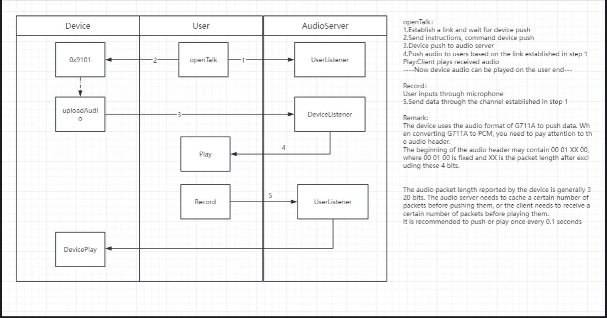

createToken
POST
/v2/openapi/system/createToken
Once a token is generated, it will expire if it is not used for more than 4 hours and needs to be re-acquired.
The maximum usage time of a token is 48 hours.
Put the token into the Authorization field of the header of other interfaces.
Request
Authorization
Add parameter in header Authorization
Example:
Authorization: ********************
Header Params
Authorization
string 
optional
Default:
{{token}}
Body Params
application/json
apiKey
string  | 
null 
required
Enter the API user key
apiSecret
string  | 
null 
required
Enter the API user secret
Example
{"apiKey":"{{apiKey}}","apiSecret":"{{apiSecret}}"}
Request Code Samples
Responses
🟢200
Success
application/json
code
integer  | 
null 
optional
data
string  | 
null 
optional
msg
string  | 
null 
optional
Example
{
  "code": 0,
  "data": "",
  "msg": ""

---destroy token ----

destroyToken
POST
/v2/openapi/system/destroyToken
Request
Authorization
Add parameter in header Authorization
Example:
Authorization: ********************
Header Params
Authorization
string 
optional
Default:
{{token}}
Body Params
application/json
object
 
Example
{}
Request Code Samples
Fetch
Axios
jQuery
XHR
Native
Request
Unirest
const myHeaders = new Headers();
myHeaders.append("Authorization", "<api-key>");
myHeaders.append("Content-Type", "application/json");

const raw = JSON.stringify({});

const requestOptions = {
   method: "POST",
   headers: myHeaders,
   body: raw,
   redirect: "follow"
};

fetch("https://mettahub.mettaxiot.com/gps/v2/openapi/system/destroyToken", requestOptions)
   .then((response) => response.text())
   .then((result) => console.log(result))
   .catch((error) => console.error(error));
Responses
🟢200
Success
application/json
code
integer 
optional
data
object 
optional
msg
string 
optional
Example
{
  "code": 0,
  "data": {},
  "msg": ""
}
Modified at almost 2 years ago
Previous
createToken
Next
customerPage

-----Customer-----

customerPage
POST
/v2/openapi/customer/page
Request
Authorization
Add parameter in header Authorization
Example:
Authorization: ********************
Header Params
Authorization
string 
optional
Default:
{{token}}
Body Params
application/json
pageSize
integer  | 
null 
optional
pageSize,default 100,can't change
Default:
100
pageIndex
integer  | 
null 
required
Default:
1
customerName
string  | 
null 
optional
customerName
customerType
string  | 
null 
optional
customerType 1-Dealer 2-Company 3-Person
status
boolean  | 
null 
required
status true:Valid false：Invalid
customerId
string  | 
null 
optional
If not specified, it will query all
subsumption
boolean  | 
null 
optional
Contain children true: contain children false: do not contain children
The default value is false
Default:
false
Example
{
    "pageSize": "100",
    "pageIndex": "1",
    "customerName": "string",
    "customerType": "string",
    "status": true,
    "customerId": "string",
    "subsumption": "false"
}
Request Code Samples
Fetch
Axios
jQuery
XHR
Native
Request
Unirest
const myHeaders = new Headers();
myHeaders.append("Authorization", "<api-key>");
myHeaders.append("Content-Type", "application/json");

const raw = JSON.stringify({
   "pageSize": "100",
   "pageIndex": "1",
   "customerName": "string",
   "customerType": "string",
   "status": true,
   "customerId": "string",
   "subsumption": "false"
});

const requestOptions = {
   method: "POST",
   headers: myHeaders,
   body: raw,
   redirect: "follow"
};

fetch("https://mettahub.mettaxiot.com/gps/v2/openapi/customer/page", requestOptions)
   .then((response) => response.text())
   .then((result) => console.log(result))
   .catch((error) => console.error(error));
Responses
🟢200
Success
application/json
code
integer  | 
null 
optional
data
object 
(PageResult«ApiCustomerVO»)
PageResult«ApiCustomerVO»
optional
records
array[object (ApiCustomerVO)]  | 
null 
optional
total
integer  | 
null 
optional
size
integer  | 
null 
optional
current
integer  | 
null 
optional
msg
string  | 
null 
optional
Example
{
  "code": 0,
  "data": {
    "records": [
      {
        "id": "",
        "pid": "",
        "customerName": "",
        "customerType": "",
        "contactName": "",
        "contactTel": "",
        "contactMail": "",
        "contactAddress": "",
        "leaf": false,
        "parentCustomerName": ""
      }
    ],
    "total": 0,
    "size": 0,
    "current": 0
  },
  "msg": ""
}
Modified at 5 months ago
Previous
destroyToken
Next
customerTree

customer
customerTree
POST
/v2/openapi/customer/tree
Request
Authorization
Add parameter in header Authorization
Example:
Authorization: ********************
Header Params
Authorization
string 
optional
Default:
{{token}}
Body Params
application/json
customerId
string  | 
null 
optional
Not specified, query the default.
Example
{
    "customerId": "string"
}
Request Code Samples
Fetch
Axios
jQuery
XHR
Native
Request
Unirest
const myHeaders = new Headers();
myHeaders.append("Authorization", "<api-key>");
myHeaders.append("Content-Type", "application/json");

const raw = JSON.stringify({
   "customerId": "string"
});

const requestOptions = {
   method: "POST",
   headers: myHeaders,
   body: raw,
   redirect: "follow"
};

fetch("https://mettahub.mettaxiot.com/gps/v2/openapi/customer/tree", requestOptions)
   .then((response) => response.text())
   .then((result) => console.log(result))
   .catch((error) => console.error(error));
Responses
🟢200
Success
application/json
code
integer  | 
null 
optional
data
array[object (ApiCustomerVO)]  | 
null 
optional
id
string  | 
null 
optional
pid
string  | 
null 
optional
customerName
string  | 
null 
optional
customerType
string  | 
null 
optional
1-Dealer 2-Company 3-Person
contactName
string  | 
null 
optional
contactTel
string  | 
null 
optional
contactMail
string  | 
null 
optional
contactAddress
string  | 
null 
optional
leaf
boolean  | 
null 
optional
true or false
parentCustomerName
string  | 
null 
optional
msg
string  | 
null 
optional
Example
{
  "code": 0,
  "data": [
    {
      "id": "",
      "pid": "",
      "customerName": "",
      "customerType": "",
      "contactName": "",
      "contactTel": "",
      "contactMail": "",
      "contactAddress": "",
      "leaf": false,
      "parentCustomerName": ""
    }
  ],
  "msg": ""
}
Modified at 5 months ago
Previous
customerPage
N

-------Video-------

README
Provide two ways
One approach is to directly use H5 pages as embeddings.
The V2 version provides parameter configuration such as automatic shutdown time setting and encoding format
The second method is to call the LiveVideo interface to obtain an http-flv live video source.
We will provide the device's video source directly, with H264 encoding as the video format and G711A as the audio format

H5 Page-V2[Recommend]
LiveV2 H5 page usage instructions document
1. Page overview
Provides an independent live broadcast window, which can be embedded into the required page through iframe. The parameters in the link can be used to control the live media server node, stream type, whether to display node information, whether to display imei information, etc.
2. Access address
https://www.mettaxiot.com/h5/#/live/v2?deviceId=711062605855&channelId=1&token=Api_uyZ9ryD8vjSY9MDbZdZYRuk7vsnUhBuv3Zv5Z7JcVcBspcA7Ap2Y9bO1xEs5EzGVzE9pnJIZ3VH48Se3QxiXSyjogVZ1qRNEa9cv&v=2&bitStream=1&streaming=singapore-1&showTop=true&showBottom=true&decoder=wcs&countdownMinutes=10
3. Parameter description
Parameter Name	Type	Required/Optional	Optional Value	Default Value	Description
deviceId	String	Required	—	—	Device ID (deviceId): The number that uniquely identifies the device. Used to specify the device to which the video stream to be queried belongs.
channelId	String	Required	1-16	—	Channel Number (channelId): The channel number that identifies the video stream. Used to specify the specific channel of the video stream to be queried.
token	String	Required	—	—	Authentication token, used to verify user permissions. By providing a valid token, ensure that only authorized users can access the page.
bitStream	Number	Optional	0/1	1	Stream type; 0 is the main stream; 1 is the sub-stream.
streaming	String	Optional	singapore-1/singapore-2/southAfrica-1/uae-1/india-1/eU-1, etc.	singapore-1	Live streaming media; for specific optional values, please refer to the liveNodes data obtained by the getNodes interface in openApi. Use the nodeValue in it to select live streaming media.
showTop	boolean	Optional	true/false	true	Whether to disable the display at the top, which displays the current live streaming type and bitstream type.
showBottom	boolean	optional	true/false	true	Whether to disable the display below, the display content is imei-ch.
decoder	String	optional	wasm/mse/wcs	wasm	Decoding method;Default wasm:wasm mode playback;mse:Open MediaSource hard decoding;wcs:Open Webcodecs hard decoding
countdownMinutes	Number	optional	-	-	Live countdown reminder, in minutes. Positive integers can be filled in. No reminder will be set if left blank.
4. Instructions for use
1.
Enter the provided address into your browser.
2.
Enter the parameters according to the page prompts. Make sure the parameters contain the correct device ID and channel number, as well as the token parameter.
3.
Click the query button or press the Enter key, and the page will display the device data within the specified time period.
4.
The page will display the real-time video stream of the specified channel of the specified device. Users can watch the real-time operation of the device.
5. Precautions
Please make sure that the Device ID and Channel Number in the parameters are correct, otherwise the video stream may not be queried correctly or incorrect results may be displayed.
Do not disclose the token parameters to others, otherwise it may allow unauthorized users to access the page or obtain sensitive information.
Page loading and data query may take some time, please be patient.
If you encounter other problems, please contact technical support for assistance.
Modified at 4 months ago

H5 page
Live H5 page usage instructions document
update records
2024-4-2 Simplified the format of passed parameters
videoList -> ids
1. Page overview
The device live stream page is used to display the real-time video stream of the specified device. Users can watch the real-time operation of the device through this page.
2. Access address
https://www.mettaxiot.com/h5/#/live?ids=997068428337-1,997068428337-2&token=Api_te5UstOR56SOMj8zCcYaHlK1aNz2SixNoWMgIS3QLNT8EpcSPAgXMAQPEORiCOSpjPBuupRfINHUMvBG5dWZYX5mNTjk6kR1I0w5
3. Parameter description
Parameter name	Parameter Type	Required/Optional	Describe
ids	array	Required	Used to specify the video stream list to be queried. The parameter value is an array containing multiple objects, each object contains the device ID and channel number. The format of each object is as follows:
deviceId1-ch1,deviceId2-ch2...
token	string	Required	Authentication token used to verify user permissions. Ensure that only authorized users can access the page by providing a valid token.
display	string	Optional	Default: There are 2 videos per line;
display=block:There will only be one video per line
4. Instructions for use
1.
Enter the provided address into your browser.
2.
Enter parameters according to the page prompts. Make sure the videoList parameter contains the correct device ID and channel number, as well as the token parameter.
3.
Click the query button or press the Enter key, and the page will display the device data within the specified time period.
4.
The page will display the real-time video stream of the specified channel of the specified device. Users can watch the real-time operation of the device.
5. Precautions
Please ensure that the device ID and channel number in the videoList parameter are correct, otherwise the video stream may not be queried correctly or incorrect results may be displayed.
Do not disclose the token parameters to others, otherwise it may allow unauthorized users to access the page or obtain sensitive information.
Page loading and data query may take some time, please be patient.
If you encounter other problems, please contact technical support for assistance.
Historical playback H5 page usage instructions document
1. Overview
This page provides a device history playback function. Users can view device data within a specified time period by specifying the device ID, channel number, start time, and end time.
2. Access address
https://www.mettaxiot.com/h5/#/history?deviceId=997061087395&channelId=2&endTime=2023-12-29%2023%3A59%3A59&startTime=2023-12-29%2000%3A00%3A00&token=Web_2M4HNDGCuW09MxS4iuD8NkoORTSWTia5sX5rK6RGsMxaA3XK5KIc4AEhqCE3t8BuQTQrd2ca0IQHXEseXxGWSLBeZSAOKtUQA3Tr
3. Parameter description
Parameter	Required/Optional	Describe
deviceId	Required	Device ID, used to specify the device to be queried.
channelId	Required	Channel number, used to specify the channel of the device to be queried.
endTime	Required	End time, in the format YYYY-MM-DDHH:MM:SS, used to specify the time range of the query.
startTime	Required	Start time, in the format YYYY-MM-DDHH:MM:SS, used to specify the time range of the query.
token	Required	Authentication token, used to verify user permissions.
4. Usage steps
1.
Open the specified address in a browser.
2.
Fill in the corresponding parameters as needed, including device ID, channel number, start time, end time and authentication token.
3.
Click the query button or press the Enter key, and the page will display the device data within the specified time period.
4.
The page will display the historical playback video of the specified channel of the specified device. Users can choose to watch historical replays for a specified period of time.
5. Precautions
Please ensure that the parameter values provided are correct, otherwise the query results may be inaccurate or the data may not be queried.
The authentication token is an important credential used to verify user permissions. Please keep it properly and do not disclose it to others.
Page loading and data query may take some time, please be patient.
If you encounter other problems, please contact technical support for assistance.
How to get Token
To obtain the token required to access the device history playback page, you need to perform the following steps:
1.
Enter the Developer project：First, you need to log in to your Developer project. Make sure you are logged into the correct account and project.
2.
View Account Info：In the project interface, find and click the "AccountInfo" section on the right. This will open a new page or panel.
3.
Get API key and API Secret：In the "AccountInfo" panel you will see the APIkey and APISecret fields. Be sure to record these two values ​​carefully as they are the key credentials used to create the token.
4.
Call createToken interface：Use the APIkey and APISecret you obtained in step 3 to generate a token by calling our createToken interface. You can do this using any tool or library that supports HTTP requests. The specific request method and parameters may vary according to the documentation of the interface, so please refer to the relevant documentation for details.
5.
Replace token：Once you have obtained the token, replace it with the token part in the address of the device's history replay page. You should now be able to successfully access the page and view the desired device history replay.
important hint：Please make sure your APIkey and APISecret remain private and do not share them with others. They are sensitive information used to verify your identity and authorize access. If someone else obtains these credentials, they could take unauthorized actions on your behalf. Therefore, please keep this information in a safe place.
If you encounter any problems in obtaining or using tokens, or need further help and guidance, please contact our technical support team. They will be happy to provide you with support and service.
Modified at 5 months ago

live
liveVideo
POST
/v2/openapi/video/live
9.26 Added parameter nodeValue, optional live streaming node
Request
Authorization
Add parameter in header Authorization
Example:
Authorization: ********************
Header Params
Authorization
string 
optional
Default:
{{token}}
Body Params
application/json
deviceId
string  | 
null 
required
deviceId
channelId
integer  | 
null 
required
channelId
start with 1
>= 1
bitstreamType
integer  | 
null 
optional
Video stream 0: Main stream 1: Sub-stream Default
nodeValue
string  | 
null 
optional
The name of the streaming server for the live stream or the default one if it is not passed The value of this parameter can be obtained through the /v2/audio/nodes interface
Example
{
    "deviceId": "string",
    "channelId": 1,
    "bitstreamType": 0,
    "nodeValue": "string"
}
Request Code Samples
Fetch
Axios
jQuery
XHR
Native
Request
Unirest
const myHeaders = new Headers();
myHeaders.append("Authorization", "<api-key>");
myHeaders.append("Content-Type", "application/json");

const raw = JSON.stringify({
   "deviceId": "string",
   "channelId": 1,
   "bitstreamType": 0,
   "nodeValue": "string"
});

const requestOptions = {
   method: "POST",
   headers: myHeaders,
   body: raw,
   redirect: "follow"
};

fetch("https://mettahub.mettaxiot.com/gps/v2/openapi/video/live", requestOptions)
   .then((response) => response.text())
   .then((result) => console.log(result))
   .catch((error) => console.error(error));
Responses
🟢200
Success
application/json
code
integer  | 
null 
optional
data
string  | 
null 
optional
msg
string  | 
null 
optional
Example
{
  "code": 0,
  "data": "",
  "msg": ""
}
Modified at 2 months ago

live
liveVideoControl
POST
/v2/openapi/video/live/control
Live broadcast control
Stream switching
Request
Authorization
Add parameter in header Authorization
Example:
Authorization: ********************
Header Params
Authorization
string 
optional
Default:
{{token}}
Body Params
application/json
deviceId
string  | 
null 
required
deviceId
channelId
integer  | 
null 
required
channelId
bitstreamType
integer  | 
null 
required
Switch stream type
0: Main stream 1: Sub stream
>= 0
<= 1
Example
{
    "deviceId": "string",
    "channelId": 0,
    "bitstreamType": 0
}
Request Code Samples
Fetch
Axios
jQuery
XHR
Native
Request
Unirest
const myHeaders = new Headers();
myHeaders.append("Authorization", "<api-key>");
myHeaders.append("Content-Type", "application/json");

const raw = JSON.stringify({
   "deviceId": "string",
   "channelId": 0,
   "bitstreamType": 0
});

const requestOptions = {
   method: "POST",
   headers: myHeaders,
   body: raw,
   redirect: "follow"
};

fetch("https://mettahub.mettaxiot.com/gps/v2/openapi/video/live/control", requestOptions)
   .then((response) => response.text())
   .then((result) => console.log(result))
   .catch((error) => console.error(error));
Responses
🟢200
Success
application/json
code
integer 
optional
data
object 
optional
msg
string 
optional
Example
{
  "code": 0,
  "data": {},
  "msg": ""
}
Modified at 2 months ago

video
getNodes
POST
/v2/openapi/video/nodes
Get all streaming nodes supported by the current server
Request
Authorization
Add parameter in header Authorization
Example:
Authorization: ********************
Header Params
Authorization
string 
optional
Default:
{{token}}
Request Code Samples
Fetch
Axios
jQuery
XHR
Native
Request
Unirest
const myHeaders = new Headers();
myHeaders.append("Authorization", "<api-key>");

const requestOptions = {
   method: "POST",
   headers: myHeaders,
   redirect: "follow"
};

fetch("https://mettahub.mettaxiot.com/gps/v2/openapi/video/nodes", requestOptions)
   .then((response) => response.text())
   .then((result) => console.log(result))
   .catch((error) => console.error(error));
Responses
🟢200
Success
application/json
code
integer  | 
null 
optional
data
object 
(ApiVideoNodesVO)
ApiVideoNodesVO
optional
liveNodes
array[object (ApiNodesVO)]  | 
null 
optional
Node configurations that can be used for live streaming
talkNodes
array[object (ApiNodesVO)]  | 
null 
optional
Node configurations that can be used for recording
replayNodes
array[object (ApiNodesVO)]  | 
null 
optional
Node configurations that can be used for replay
msg
string  | 
null 
optional
Example
{
  "code": 0,
  "data": {
    "liveNodes": [
      {
        "default": false,
        "nodeName": "",
        "nodeValue": "",
        "nodeOrder": ""
      }
    ],
    "talkNodes": [
      {
        "default": false,
        "nodeName": "",
        "nodeValue": "",
        "nodeOrder": ""
      }
    ],
    "replayNodes": [
      {
        "default": false,
        "nodeName": "",
        "nodeValue": "",
        "nodeOrder": ""
      }
    ]
  },
  "msg": ""
}
Modified at 2 months ago

-----Audio------

README
Flow
image.png
Demo
https://github.com/mettaxIot/twoWayTalk
1、Call the HTTP interface to obtain the Token
/v2/openapi/audio/talk
Unable to select the corresponding audio node. Not recommended, please use "/v2/openapp/audio/talk/plus“

request:
{"deviceId":"105045133913","channelId":1}

response：
{
    "code": 0,
    "data": "3cdd1248b12126c3594b",
    "msg": ""
}
/v2/openapi/audio/talk/plus
request:
{"deviceId":"105045133913","channelId":1,"talkChannel":"india-1"}

response：
{
    "code": 0,
    "data": {
        "deviceId": "105045133913",
        "channelId": 1,
        "talkChannel": "india-1",
        "talkUrl": "wss://india.mettaxiot.com/talk/websocket/105045133913/3cdd1248b12126c3594b"
    },
    "msg": ""
}
2.create WebSocket
talkNode
Different nodes will have different call addresses
标题	
Default	wss://m1.mettaxiot.com/talk/websocket/
india	wss://india.mettaxiot.com/talk/websocket/
uae	wss://uae.mettaxiot.com/talk/websocket/
southafrica	wss://southafrica.mettaxiot.com/talk/websocket/
param
imei：deviceId
token：from http interface
callback：
back
image.png
msg.data instanceof Blob: Audio data
let data = JSON.parse(msg.data);
data.code === 'connect':Link successfully established
data.code === 'repeat':Repeated connections indicate that a new user has initiated a conversation with the device, and the current link has expired
data.code === 'release':The device has disconnected from the link
data.code === 'network':data.deviceTime is the timestamp of data on the device (related to the time zone set by the device)
demo
getSocket(imei, token, callback) {

    const url = 'wss://www.mettaxiot.com/talk/websocket/' + imei + '/' + token;
    //    const url = wss://m1.mettaxiot.com/talk/websocket/105045133913/3cdd1248b12126c3594b

    let _this = this;

    this.socket = new WebSocket(url);

     this.socket.onopen = function () {
        _this.loading = true;
    };
   
    this.socket.onmessage = function (msg) {
        if (msg.data instanceof Blob) {
            _this.loading = false;
            _this.receive(msg);
        } else if (msg.data === 'repeat') {
            _this.loading = false;
            _this.$message.warning(_this.$t('device busy'));
            callback();
        } else if (msg.data === 'error') {
            _this.loading = false;
            _this.$message.warning(_this.$t('device error'));
            callback();
        } else if (msg.data.code === 'network'){
        //msg.data :{"deviceTime": "1725976558122",  "serverTime": "1725947758702",  "code": "network"}
        //devicetime uses the device's time zone 
        //serverTime uses 0 time zone
        }
    };

    this.socket.onclose = function (e) {
        _this.loading = false;
        console.log(e, 'onclose');
    };

    this.socket.onerror = function () {
        _this.loading = false;
    };

}
In the above example, the 'getSocket' function is used to establish a WebSocket connection with the specified device. It first constructs the URL for the WebSocket connection based on the incoming 'imei' and 'token', and then creates the 'WebSocket' object. Next, it sets up event handlers for 'onopen', 'onmessage', 'onclose', and 'oneerror' to handle situations where a connection is opened, a message is received, a connection is closed, and an error occurs, respectively.
When the connection is opened, set the 'loading' status to 'true' and print a message to the console. When receiving a message, perform corresponding operations based on the content of the message, such as receiving Blob data, displaying warning messages, or calling callback functions. When the connection is closed or an error occurs, set the 'loading' status to 'false' and print the corresponding message to the console.
Note: The '_this' variable in the example is used to access the external context (i.e.' this') within the callback function within the closure. This is because the 'this' pointer in the callback function may change, so it is usually necessary to save the reference to the external context in a variable for use in the callback function
3.receive audio
Explain
The following is an implementation of the 'receive' method, which is responsible for processing audio data received from WebSocket.
Audio Format：G711A

receive(msg) {
  
    if (typeof msg.data === 'string') {
        console.log(msg.data); 
    }
  
    if (msg.data instanceof Blob) {

        var audio = document.getElementById('LogAudioPlayer');
        audio.volume = this.volume;  
        if (!(audio.ended || audio.paused)) {
            audio.pause();
        }
        var end = function (blob) {          
            audio.src = (window.URL || window.webkitURL).createObjectURL(blob);
            audio.play();
        };
       
        var wav = Recorder['g711a2wav'];
        if (wav) {
            var wavData = msg.data;  
            wav(
                wavData,
                function (blob) {                    
                    end(blob);
                },
                function (msg) {
                    
                }
            );
        } else {           
            console.log('end blob'); 
        }
    }
}
Eplain
-This method depends on the presence of an audio element with the ID 'LogAudioPlayer' on the page.
-Assuming the 'Recorder' object is an object containing audio processing methods, and 'g711a2wav' is one of the methods used to convert G.711 encoded audio data into WAV format. In practical applications, it is necessary to ensure that the 'Recorder' object and its methods have been correctly implemented and introduced.
-The error handling in the method is relatively simple, only outputting prompt information through the console. In practical applications, more detailed error handling and user feedback may be required.
4.Microphone
Explain
Control the status of the microphone. When the microphone is turned on, record the current platform microphone sound and send it to the device.
Suggested parameters:
channelCount :1
bitRate:16
sampleRate:16000
demo

changeMicrophone() {
    this.isMicrophone = !this.isMicrophone;
    if (this.isMicrophone) {
        this.initRecord(); 
    } else {
        this.closeRecord(); 
    }
},
This function is used to control the state of the microphone. When the 'changeMicrophone' method is called, the value of 'this. isMicrophone' is reversed, meaning that if the microphone was originally in an open state, it becomes closed, and vice versa. Subsequently, based on the current state of 'this. isMicrophone', perform the corresponding operation: if the microphone state is on, call the 'initRecord' method to initialize the recording; If the microphone status is off, call the 'closeRecord' method to turn off recording (please note that the implementation of the 'closeRecord' method is not provided in the given code snippet).

initRecord() {
    let _this = this;
    this.record = Recorder({
        type: 'unknown',
        onProcess: function (buffers, powerLevel, bufferDuration, bufferSampleRate) {
            _this.RealTimeSendTry(buffers, bufferSampleRate, false);
        }
    });

    this.record.open(
        function () {
            _this.record.start(); 
            _this.RealTimeSendTryReset(); 
        },
        function (msg, isUserNotAllow) {
            console.log((isUserNotAllow ? 'UserNotAllow，' : '') + msg);
        }
    );
}
The initRecord method is used to initialize the recording function. It first creates an instance of 'Recorder' and configures the relevant parameters for recording. Among them, 'onProcess' is a callback function that is called during the recording process to perform real-time processing on the recorded audio data. In this example, audio data is passed to _this The RealTimeSendTry method may be used to send audio data in real-time to a device.
Next, call the 'this. record. open' method to open the recording device. This method accepts two callback functions as parameters: the first callback function is called after the recording device is successfully opened, and it will start recording and call _this The RealTimeSendTryReset method is used to reset the environment (possibly in preparation for sending new audio data); The second callback function handles the situation where the recording device fails to open. It will print the error message to the console. If it is because the user does not allow recording, a 'UserNotAllow' prompt will be added before the error message.
By using the methods of 'changeMicrophone' and 'initRecord', it is possible to control the microphone and initialize the recording. In practical applications, more details need to be handled, such as error handling, saving and playing audio files, etc. At the same time, it is also necessary to ensure that users have authorized recording permissions and respect their privacy.
closeRecord() {
    if (this.record === null) {
        return;
    }

    this.record.close(); 
    this.RealTimeSendTry([], 0, true); 

    let _this = this;
    this.record.stop(
        function (blob, duration) {
            var newRec = Recorder({ type: 'g711a' });
            var pcm = Recorder.SampleData(_this.record.buffers, _this.record.srcSampleRate, _this.record.srcSampleRate).data;
            newRec.mock(pcm, _this.record.srcSampleRate);

            newRec.stop(function (blob, duration) {
                var audio = document.getElementById('LogAudioPlayer');
                audio.style.display = 'inline-block';
                if (!(audio.ended || audio.paused)) {
                    audio.pause();
                }

                var end = function (blob) {
                    audio.src = (window.URL || window.webkitURL).createObjectURL(blob);
                    audio.play(); 
                };

                var wav = Recorder['g711a2wav'];
                if (wav) {
                    var wavData = blob;
                    wav(
                        wavData,
                        function (blob) {
                            end(blob);
                        },
                        function (msg) {
                            console.error(msg);
                        }
                    );
                } else {
                    end(blob);
                }
            });
        },
        function (msg) {
            console.info(msg);
        },
        true
    );

    this.record = null;
},

RealTimeSendTryReset() {
    this.realTimeSendTryChunks = null;
},

RealTimeSendTry(buffers, bufferSampleRate, isClose) {
    let _this = this;
    if (this.realTimeSendTryChunks == null) {
        this.realTimeSendTryNumber = 0;
        this.transferUploadNumberMax = 0;
        this.realTimeSendTryChunk = null;
        this.realTimeSendTryChunks = [];
    }

    if (this.testBitRate == 16 && this.SendFrameSize % 2 == 1) {
        console.log('SendFrameSize error');
        return;
    }

    var pcm = [];
    var pcmSampleRate = 0;
    if (buffers.length > 0) {       
        var chunk = Recorder.SampleData(buffers, bufferSampleRate, this.testSampleRate, this.realTimeSendTryChunk);

        for (var i = this.realTimeSendTryChunk ? this.realTimeSendTryChunk.index : 0; i < chunk.index; i++) {
            buffers[i] = null;
        }
        this.realTimeSendTryChunk = chunk; 

        pcm = chunk.data;
        pcmSampleRate = chunk.sampleRate;

    }
   
    if (pcm.length > 0) {
        this.realTimeSendTryChunks.push({ pcm: pcm, pcmSampleRate: pcmSampleRate });
    }

    var chunkSize = this.SendFrameSize / (this.testBitRate / 8); 

    pcm = new Int16Array(chunkSize);
    pcmSampleRate = 0;
    var pcmOK = false;
    var pcmLen = 0;
    for1: for (var i1 = 0; i1 < this.realTimeSendTryChunks.length; i1++) {
        chunk = this.realTimeSendTryChunks[i1];
        pcmSampleRate = chunk.pcmSampleRate;

        for (var i2 = chunk.offset || 0; i2 < chunk.pcm.length; i2++) {
            pcm[pcmLen] = chunk.pcm[i2];
            pcmLen++;

            if (pcmLen == chunkSize) {
                pcmOK = true;
                chunk.offset = i2 + 1;
                for (var i3 = 0; i3 < i1; i3++) {
                    this.realTimeSendTryChunks.splice(0, 1);
                }
                break for1;
            }
        }
    }
    
    if (!pcmOK) {
        if (isClose) {
            var number = ++this.realTimeSendTryNumber;
            this.TransferUpload(number, null, 0, null, isClose);
        }
        return;
    }

    number = ++this.realTimeSendTryNumber;
    var encStartTime = Date.now();

    var recMock = Recorder({
        type: 'g711a',
        sampleRate: this.testSampleRate, 
        bitRate: this.testBitRate 
    });
    recMock.mock(pcm, pcmSampleRate);
    recMock.stop(
        function (blob, duration) {
            blob.encTime = Date.now() - encStartTime;
            _this.TransferUpload(number, blob, duration, recMock, false);
            _this.RealTimeSendTry([], 0, isClose);
        },
        function (msg) {
            console.log(msg);
        }
    );
},

TransferUpload(number, blobOrNull, duration, blobRec, isClose) {
    this.transferUploadNumberMax = Math.max(this.transferUploadNumberMax, number);
    if (blobOrNull) {
        var blob = blobOrNull;
        // var encTime = blob.encTime;
        this.socket.send(blob);
    }
    if (isClose) {
        console.log('No.' + (number < 100 ? ('000' + number).substr(-3) : number) + ':stop');
    }
},
Explain
In the above code, the 'changeMicrophone' method is used to switch the state of the microphone. When the microphone is turned on, call the 'initRecord' method to initialize the recording function; When the microphone is turned off, call the 'closeRecord' method to stop recording and clean up related resources.
The 'initRecord' method initializes the recording function and configures recording parameters by creating an instance of the 'Recorder'. During the recording process, pause by using 'onProcess'
Modified at over 1 year ago

------Talk-Plus--------
talkPlus
POST
/v2/openapi/audio/talk/plus
multi node version
Request
Authorization
Add parameter in header Authorization
Example:
Authorization: ********************
Header Params
Authorization
string 
optional
Default:
{{token}}
Body Params
application/json
deviceId
string  | 
null 
required
deviceId
channelId
integer  | 
null 
required
channelId
>= 1
nodeValue
string  | 
null 
optional
The value of this parameter can be obtained through the /v2/audio/nodes interface
Example
{
    "deviceId": "string",
    "channelId": 1,
    "nodeValue": "string"
}
Request Code Samples
Fetch
Axios
jQuery
XHR
Native
Request
Unirest
const myHeaders = new Headers();
myHeaders.append("Authorization", "<api-key>");
myHeaders.append("Content-Type", "application/json");

const raw = JSON.stringify({
   "deviceId": "string",
   "channelId": 1,
   "nodeValue": "string"
});

const requestOptions = {
   method: "POST",
   headers: myHeaders,
   body: raw,
   redirect: "follow"
};

fetch("https://mettahub.mettaxiot.com/gps/v2/openapi/audio/talk/plus", requestOptions)
   .then((response) => response.text())
   .then((result) => console.log(result))
   .catch((error) => console.error(error));
Responses
🟢200
Success
application/json
code
integer  | 
null 
optional
data
object 
(ApiTalkVO)
ApiTalkVO
optional
deviceId
string  | 
null 
optional
channelId
integer  | 
null 
optional
talkChannel
string  | 
null 
optional
if you don t pass it the default value is used
The value can be obtained from the interface /v2/openapi/video/nodes
talkUrl
string  | 
null 
optional
talk socket address
msg
string  | 
null 
optional
Example
{
  "code": 0,
  "data": {
    "deviceId": "",
    "channelId": 0,
    "talkChannel": "",
    "talkUrl": ""
  },
  "msg": ""
}
Modified at about 1 year ago
Previous
talk「Deprecated」
Next
filePageV2
